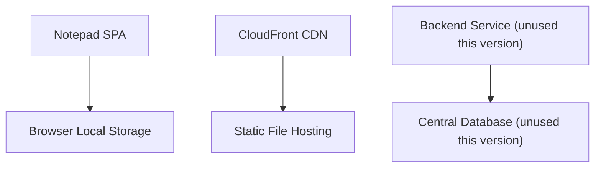
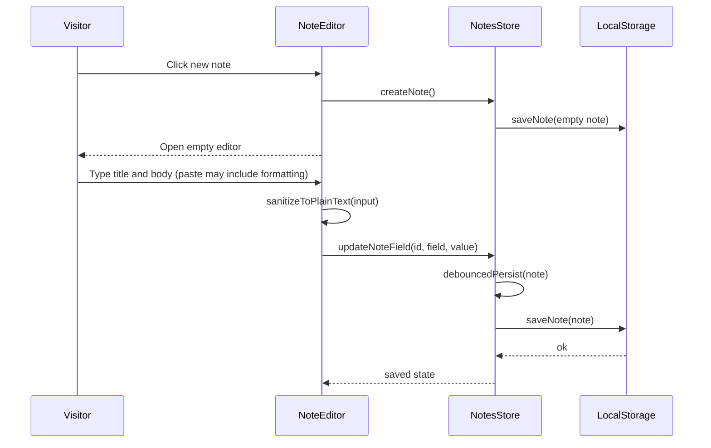
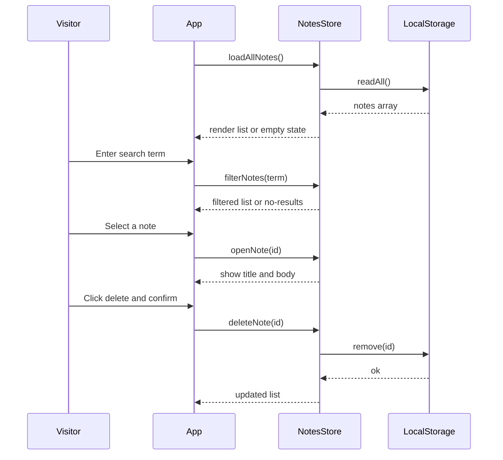
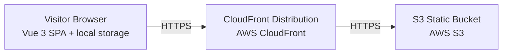

# Architecture

> Maintained by QuorQ AI SDLC. Text between `sdlc:auto` markers is regenerated; anything outside them is yours and is kept.

<!-- sdlc:auto:start narrative -->
## Overview

### ARCH-001 · approved · source: architecture

Approved (v1) backend-less architecture: a Vue 3 SPA holding all logic and data client-side, delivered as static files from AWS S3/CloudFront, persisting notes only in browser local storage.

Components:
- spa: Notepad SPA (Vue 3) -- note list, editor, search, create/delete UI, plain-text enforcement, debounced auto-save, responsive layout; all logic in-browser.
- local_store: Browser Local Storage (localStorage/IndexedDB) -- the real and only data store, holding id/title/body/timestamps per note, private per browser, no sync.
- cdn: CloudFront CDN -- delivers the static SPA bundle globally over HTTPS at near-zero cost.
- hosting: AWS S3 -- stores/serves built static SPA files (HTML/JS/CSS/assets).
- backend: Spring Boot 4.1 (unused this version) -- named to satisfy approved stack; no note data or APIs.
- database: PostgreSQL 16 (unused this version) -- named to satisfy approved stack; stores no notes.

**Related:** EPIC-001, EPIC-002, EPIC-003, EPIC-004

### ARCH-002 · approved · source: architecture:critical_path

Critical path: creating a note and auto-saving plain text.

Visitor creates a new separate note, edits title and plain-text body; changes are debounced and auto-persisted to local storage with no manual save. Pasted rich formatting is stripped to plain text.

**Related:** US-001, US-002, US-003, US-004

### ARCH-003 · approved · source: architecture:critical_path

Critical path: browsing, opening, searching, and deleting notes across visits.

On load the SPA reads all notes from local storage and renders the list (or empty state). Visitor searches by title/body, opens a note to view/edit, and deletes a note after confirmation. Notes remain present on reopening the app in the same browser.

**Related:** US-005, US-006, US-007, US-008, US-009

### ARCH-004 · approved · source: architecture:technology_decisions

Restated approved technology stack and rationale for each choice, including the deliberately unused backend/database.

- Frontend: Vue 3 (alts: React, Svelte) -- reactivity drives list/editor/auto-save/search; builds to static files for S3/CloudFront.
- Backend: Spring Boot 4.1 (alts: Node/Express, FastAPI) -- restated to honor approved stack; carries no note data, no note APIs, by deliberate backend-less design.
- Database: PostgreSQL 16 (alts: MySQL, DynamoDB) -- restated to honor approved stack; holds no data since notes live only in browser local storage.
- Cloud: AWS (alts: Netlify, Cloudflare Pages) -- S3 + CloudFront deliver the static build fast and cheaply worldwide over HTTPS.

### ARCH-005 · approved · source: architecture:entities_and_deployment

Data model (note entity) and deployment topology.

Entity: note (id, title, body, created_at, updated_at), stored only in browser local storage. Deployment nodes: S3 Static Bucket (static object storage), CloudFront Distribution (global edge CDN), Visitor Browser (Vue 3 SPA + local storage, desktop and mobile web browsers).

**Related:** EPIC-001, EPIC-003
<!-- sdlc:auto:end narrative -->

<!-- sdlc:auto:start building-blocks -->
## Building Block View

| ID | Name | Technology | Responsibility | Depends on |
|---|---|---|---|---|
| spa | Notepad SPA | Vue 3 | Single-page Vue app providing the note list, editor, search, create/delete UI, plain-text enforcement, debounced auto-save, responsive layout, and all application logic entirely in the browser. | local_store |
| local_store | Browser Local Storage | Browser localStorage / IndexedDB | Persists each note (id, title, plain-text body, timestamps) in the visitor's own browser between visits via localStorage/IndexedDB; the real and only data store for this version, private per browser with no sync. | — |
| cdn | CloudFront CDN | AWS CloudFront | Delivers the static SPA bundle quickly and reliably to desktop and mobile visitors worldwide over HTTPS at near-zero cost. | hosting |
| hosting | Static File Hosting | AWS S3 | Stores and serves the built static SPA files (HTML, JS, CSS, assets). | — |
| backend | Backend Service (unused this version) | Spring Boot 4.1 | Named to satisfy the approved stack; carries no note data and exposes no note APIs in this version because the product owner chose browser-only storage with no server component. | database |
| database | Central Database (unused this version) | PostgreSQL 16 | Named to satisfy the approved stack; stores no notes in this version because notes live only in each visitor's browser by design. | — |

<!-- sdlc:auto:end building-blocks -->

<!-- sdlc:auto:start runtime -->
## Runtime View

### Create note and auto-save plain text

Visitor creates a new separate note, edits title and plain-text body, and changes are debounced and auto-persisted to local storage with no manual save. Pasted rich formatting is stripped to plain text.

- **Components:** spa, local_store
- **Modules:** NoteEditor.vue, useNotesStore, localStorageRepository, plainTextSanitizer
- **Key functions:** createNote(), updateNoteField(id, field, value), sanitizeToPlainText(input), debouncedPersist(note), saveNote(note)

### Browse, open, search, delete across visits

On load the SPA reads all notes from local storage and renders the list (or empty state). Visitor searches by title/body, opens a note to view and edit, and deletes a note after confirmation. Notes remain present on reopening the app in the same browser.

- **Components:** spa, local_store
- **Modules:** NoteList.vue, SearchBar.vue, DeleteConfirm.vue, useNotesStore, localStorageRepository
- **Key functions:** loadAllNotes(), filterNotes(term), openNote(id), confirmDelete(id), deleteNote(id)

<!-- sdlc:auto:end runtime -->

<!-- sdlc:auto:start deployment-view -->
## Deployment View

| Name | Service | Runtime | Scaling | Environment |
|---|---|---|---|---|
| S3 Static Bucket | AWS S3 | Static object storage | Managed by AWS, effectively unlimited for static files | dev |
| CloudFront Distribution | AWS CloudFront | Global edge CDN | Auto-scaled at edge, pay-per-use | dev |
| Visitor Browser | Vue 3 SPA + local storage | Desktop and mobile web browsers | Per-device; no central load | dev |

| Source | Target | Protocol |
|---|---|---|
| CloudFront Distribution | S3 Static Bucket | HTTPS |
| Visitor Browser | CloudFront Distribution | HTTPS |

<!-- sdlc:auto:end deployment-view -->

<!-- sdlc:auto:start decisions -->
## Architecture Decisions

| Layer | Choice | ADR |
|---|---|---|
| Frontend | Vue 3 | [ADR-0001](adr/frontend.md) |
| Backend | Spring Boot 4.1 | [ADR-0002](adr/backend.md) |
| Database | PostgreSQL 16 | [ADR-0003](adr/database.md) |
| Cloud | AWS | [ADR-0004](adr/cloud.md) |
<!-- sdlc:auto:end decisions -->

<!-- sdlc:auto:start links -->
## Related Documents

- [Data Model](data-model.md)
- [API Specification](api/openapi.yaml)
- [Architecture Decision Records](adr/README.md)
<!-- sdlc:auto:end links -->
