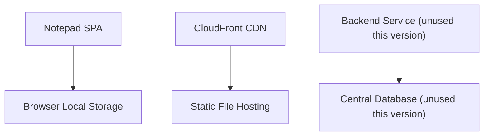
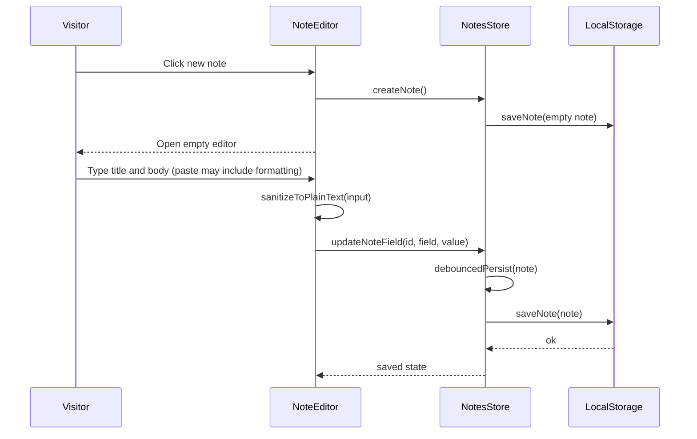
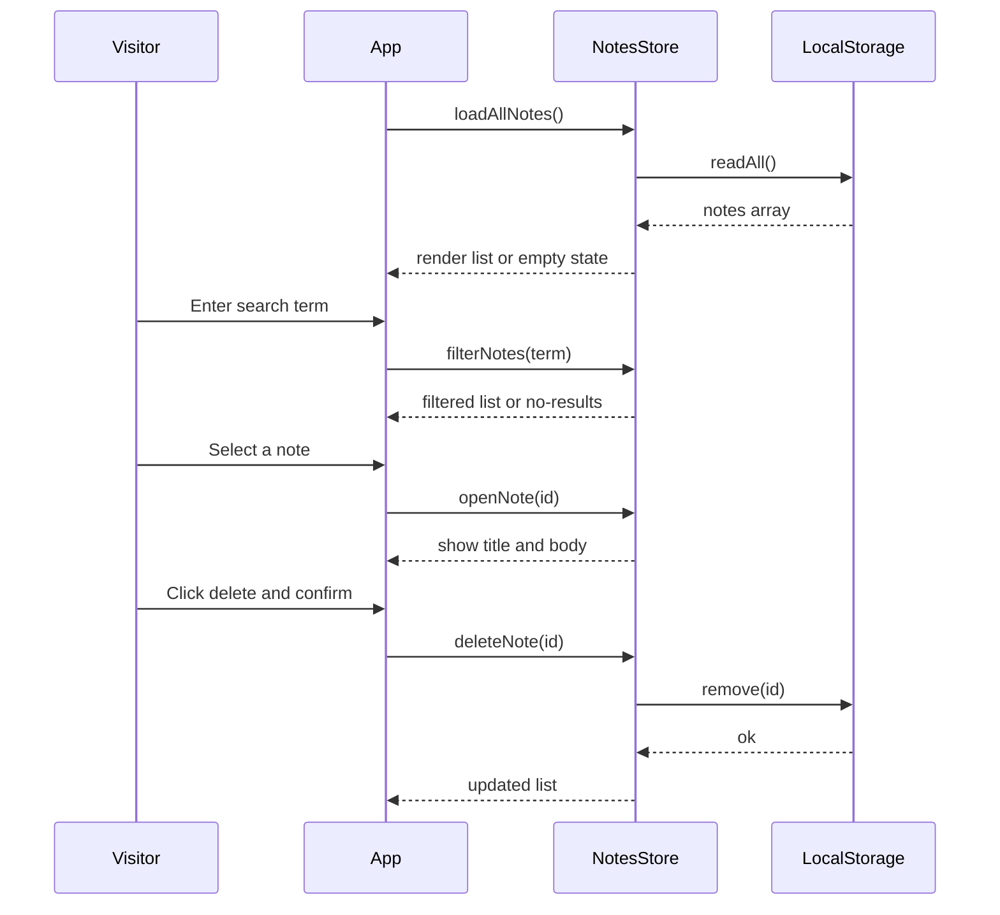
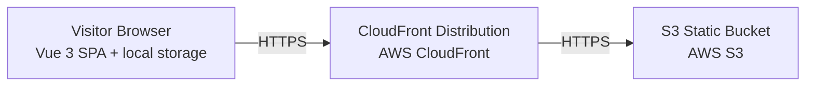

# Architecture

> Maintained by QuorQ AI SDLC. Text between `sdlc:auto` markers is regenerated; anything outside them is yours and is kept.

<!-- sdlc:auto:start narrative -->
## Overview

### ARCH-001 · approved · source: architecture:summary

_2026-11-06_

Note Pad 7 is a free, login-free, English-only responsive web notepad with all logic and data living entirely in the visitor's browser.

Approved stack: Vue 3 SPA delivered as static files from AWS S3 behind CloudFront. Per the product owner's deliberate decision, notes persist only in browser local storage (localStorage/IndexedDB) -- no cross-device sync, no cloud backup, no server-side storage. Spring Boot 4.1 and PostgreSQL 16 are named to satisfy the approved stack but hold and serve no note data in this version, since the design is intentionally backend-less. All capabilities (create, title, edit plain text, auto-save, browse, open, search, delete, persistence between visits) are implemented client-side against local storage.

### ARCH-002 · approved · source: architecture:components:spa

_2026-11-06_

Notepad SPA (Vue 3) is the single-page application containing all application logic and UI.

Component 'spa': Single-page Vue app providing the note list, editor, search, create/delete UI, plain-text enforcement, debounced auto-save, and responsive layout -- all application logic runs entirely in the browser.

### ARCH-003 · approved · source: architecture:components:local_store

_2026-11-06_

Browser Local Storage is the real and only data store for this version.

Component 'local_store' (browser localStorage / IndexedDB): persists each note (id, title, plain-text body, timestamps) in the visitor's own browser between visits. Private per browser, with no sync across devices.

**Related:** ARCH-002

### ARCH-004 · approved · source: architecture:components:cdn

_2026-11-06_

CloudFront CDN delivers the static SPA bundle worldwide.

Component 'cdn' (AWS CloudFront): delivers the static SPA bundle quickly and reliably to desktop and mobile visitors worldwide over HTTPS at near-zero cost.

**Related:** ARCH-005

### ARCH-005 · approved · source: architecture:components:hosting

_2026-11-06_

Static File Hosting stores and serves the built SPA assets.

Component 'hosting' (AWS S3): stores and serves the built static SPA files (HTML, JS, CSS, assets).

**Related:** ARCH-004

### ARCH-006 · approved · source: architecture:components:backend

_2026-11-06_

Backend Service is named to satisfy the approved stack but is unused in this version.

Component 'backend' (Spring Boot 4.1): carries no note data and exposes no note APIs in this version, because the product owner chose browser-only storage with no server component.

**Related:** ARCH-001

### ARCH-007 · approved · source: architecture:components:database

_2026-11-06_

Central Database is named to satisfy the approved stack but is unused in this version.

Component 'database' (PostgreSQL 16): stores no notes in this version, because notes live only in each visitor's browser by design.

**Related:** ARCH-001

### ARCH-008 · approved · source: architecture:critical_paths:create_autosave

_2026-11-06_

Critical path for creating a note and auto-saving plain text.

Visitor creates a new separate note, edits title and plain-text body; changes are debounced and auto-persisted to local storage with no manual save. Pasted rich formatting is stripped to plain text.

**Related:** ARCH-002, ARCH-003

### ARCH-009 · approved · source: architecture:critical_paths:browse_search_delete

_2026-11-06_

Critical path for browsing, opening, searching, and deleting notes across visits.

On load, the SPA reads all notes from local storage and renders the list (or an empty state). Visitor searches by title/body, opens a note to view and edit, and deletes a note after confirmation. Notes remain present on reopening the app in the same browser.

**Related:** ARCH-002, ARCH-003

### ARCH-010 · approved · source: architecture:entities:note

_2026-11-06_

The 'note' entity defines the data shape persisted in local storage.

Fields: id, title, body, created_at, updated_at. This is the sole persisted entity in the system.

**Related:** ARCH-003

### ARCH-011 · approved · source: architecture:deployment_nodes

_2026-11-06_

Deployment topology consists of three nodes: S3 bucket, CloudFront distribution, and the visitor's browser.

S3 Static Bucket (AWS S3): static object storage for the built SPA. CloudFront Distribution (AWS CloudFront): global edge CDN delivering the SPA. Visitor Browser (Vue 3 SPA + local storage): runs the app and holds all note data on desktop and mobile web browsers.

**Related:** ARCH-004, ARCH-005, ARCH-002

### ARCH-012 · approved · source: architecture:technology_decisions

_2026-11-06_

Four technology decisions were approved: Vue 3 frontend, Spring Boot backend (unused), PostgreSQL database (unused), and AWS cloud hosting.

Frontend: Vue 3 (alternatives considered: React, Svelte) -- approved stack; reactivity cleanly drives the note list, editor, debounced auto-save, and reactive search filtering, and builds to static files shipped from S3/CloudFront with no backend. Backend: Spring Boot 4.1 (alternatives: Node/Express, FastAPI) -- approved stack, restated to honor it exactly; carries no note data and exposes no note APIs in this version due to the backend-less design. Database: PostgreSQL 16 (alternatives: MySQL, DynamoDB) -- approved stack, restated to honor it exactly; holds no data in this version since notes live only in browser local storage. Cloud: AWS (alternatives: Netlify, Cloudflare Pages) -- approved stack; S3 hosts the static Vue build and CloudFront delivers it fast and reliably to desktop and mobile visitors globally over HTTPS at near-zero cost.

**Related:** ARCH-002, ARCH-006, ARCH-007, ARCH-004, ARCH-005
<!-- sdlc:auto:end narrative -->

<!-- sdlc:auto:start building-blocks -->
## Building Block View

| ID | Name | Technology | Responsibility | Depends on |
|---|---|---|---|---|
| spa | Notepad SPA | Vue 3 | Single-page Vue app providing the note list, editor, search, create/delete UI, plain-text enforcement, debounced auto-save, responsive layout, and all application logic entirely in the browser. | local_store |
| local_store | Browser Local Storage | Browser localStorage / IndexedDB | Persists each note (id, title, plain-text body, timestamps) in the visitor's own browser between visits via localStorage/IndexedDB; the real and only data store for this version, private per browser with no sync. | — |
| cdn | CloudFront CDN | AWS CloudFront | Delivers the static SPA bundle quickly and reliably to desktop and mobile visitors worldwide over HTTPS at near-zero cost. | hosting |
| hosting | Static File Hosting | AWS S3 | Stores and serves the built static SPA files (HTML, JS, CSS, assets). | — |
| backend | Backend Service (unused this version) | Spring Boot 4.1 | Named to satisfy the approved stack; carries no note data and exposes no note APIs in this version because the product owner chose browser-only storage with no server component. | database |
| database | Central Database (unused this version) | PostgreSQL 16 | Named to satisfy the approved stack; stores no notes in this version because notes live only in each visitor's browser by design. | — |

<!-- sdlc:auto:end building-blocks -->

<!-- sdlc:auto:start runtime -->
## Runtime View

### Create note and auto-save plain text

Visitor creates a new separate note, edits title and plain-text body, and changes are debounced and auto-persisted to local storage with no manual save. Pasted rich formatting is stripped to plain text.

- **Components:** spa, local_store
- **Modules:** NoteEditor.vue, useNotesStore, localStorageRepository, plainTextSanitizer
- **Key functions:** createNote(), updateNoteField(id, field, value), sanitizeToPlainText(input), debouncedPersist(note), saveNote(note)

### Browse, open, search, delete across visits

On load the SPA reads all notes from local storage and renders the list (or empty state). Visitor searches by title/body, opens a note to view and edit, and deletes a note after confirmation. Notes remain present on reopening the app in the same browser.

- **Components:** spa, local_store
- **Modules:** NoteList.vue, SearchBar.vue, DeleteConfirm.vue, useNotesStore, localStorageRepository
- **Key functions:** loadAllNotes(), filterNotes(term), openNote(id), confirmDelete(id), deleteNote(id)

<!-- sdlc:auto:end runtime -->

<!-- sdlc:auto:start deployment-view -->
## Deployment View

| Name | Service | Runtime | Scaling | Environment |
|---|---|---|---|---|
| S3 Static Bucket | AWS S3 | Static object storage | Managed by AWS, effectively unlimited for static files | dev |
| CloudFront Distribution | AWS CloudFront | Global edge CDN | Auto-scaled at edge, pay-per-use | dev |
| Visitor Browser | Vue 3 SPA + local storage | Desktop and mobile web browsers | Per-device; no central load | dev |

| Source | Target | Protocol |
|---|---|---|
| CloudFront Distribution | S3 Static Bucket | HTTPS |
| Visitor Browser | CloudFront Distribution | HTTPS |

<!-- sdlc:auto:end deployment-view -->

<!-- sdlc:auto:start decisions -->
## Architecture Decisions

| Layer | Choice | ADR |
|---|---|---|
| Frontend | Vue 3 | [ADR-0001](adr/frontend.md) |
| Backend | Spring Boot 4.1 | [ADR-0002](adr/backend.md) |
| Database | PostgreSQL 16 | [ADR-0003](adr/database.md) |
| Cloud | AWS | [ADR-0004](adr/cloud.md) |
<!-- sdlc:auto:end decisions -->

<!-- sdlc:auto:start links -->
## Related Documents

- [Data Model](data-model.md)
- [API Specification](api/openapi.yaml)
- [Architecture Decision Records](adr/README.md)
<!-- sdlc:auto:end links -->
